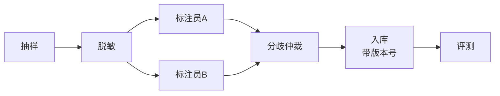

# 评测方案与实施

## 1. 为什么需要专门的评测

通用 LLM 评测（MMLU、C-Eval）不能回答三个问题：

1. 这份病历里的**这个**问题，系统能不能发现？
2. 系统给出的依据，医生能不能**核对**？
3. 在**你们的**算力与病历分布下，时延和降级是否可接受？

因此本项目采用"金标准集 + 分层指标 + 线上闭环"的评测体系，目标是让每次提示词、模型、规则变更都有可比较的数字。

## 2. 指标定义

设第 *i* 个用例的预期问题集合为 $E_i$，系统输出问题集合为 $F_i$。

| 指标 | 公式 | 说明 |
| --- | --- | --- |
| 缺陷召回率（micro） | $\frac{\sum_i |E_i \cap F_i|}{\sum_i |E_i|}$ | 主指标，衡量"该发现的发现了没有" |
| 误报数 | $|F_i \setminus E_i|$ | 供人工判断，不直接计入自动分 |
| 证据核验通过率 | $\frac{\#\{f \in F: f.evidence.state=verified\}}{\#\{f \in F: f.evidence \ne \varnothing\}}$ | 衡量可追溯性 |
| 无依据结论拦截率 | $\frac{\#\{invalid\}}{\#\{invalid\}+\#\{invalid 被误采纳\}}$ | 设计上应为 100% |
| ICD Top-1 | 首位编码 ∈ 预期编码 | 主要诊断 |
| ICD Top-3 | 前三含预期编码 | 候选可用性 |
| 端到端时延 | P50 / P95 | 从请求到结果 |
| TTFT | 首 token 时间 | 仅流式 |
| 降级率 | `degraded` 用例数 / 总用例 | 稳定性 |
| 采纳率（线上） | accepted / (accepted + rejected) | 产品价值 |

### 2.1 为什么召回是主指标

质控场景下，漏报意味着风险暴露；误报意味着医生多花 10 秒判断。在产品早期，优先保证召回，再用"待核验"与阈值控制误报的展示方式。

但召回不能靠"什么都报"刷高——因此同时监控误报数与采纳率，形成制衡。

### 2.2 指标口径注意事项

- 金标准集采用"预期问题清单"，不是"穷举所有问题"，因此**额外发现不一定是错**，需人工复核后再计入误报；
- 同一问题可能被规则与模型同时命中，评测前按 `(code, section, 区间重叠)` 去重；
- 召回按"编码级"匹配，不要求文案一致；
- ICD 评测只看编码，不看理由文案。

## 3. 金标准集

### 3.1 当前样例

`data/eval/golden.jsonl` 共 5 例：

| 用例 | 场景 | 预期 |
| --- | --- | --- |
| G001 | 规范住院病历 | 零问题（验证误报） |
| G002 | 缺项 + 性别矛盾 + 危急值 + 剂量 + 否定式矛盾 | 7 条规则 |
| G003 | 糖尿病随访，现病史缺失 | 缺项 + ICD E11.9 |
| G003B | 主诉过长且含诊断 | R002 + R003 |
| G004 | 胸痛危急值 | R006 + ICD I21.9 |

### 3.2 扩充计划

| 维度 | 目标 | 说明 |
| --- | --- | --- |
| 科室 | 内科、外科、妇产、儿科、急诊 | 每科 ≥ 20 例 |
| 缺陷类型 | 9 条规则 × 每类 ≥ 10 例 | 覆盖边界 |
| 病历长度 | 短（<800）、中、长（>4000） | 验证分片 |
| 书写质量 | 规范、一般、差 | 避免只测"坏病历" |
| 对抗样本 | 提示词注入、模板残留、复制粘贴 | 安全性 |

### 3.3 标注流程



- 标注规范：问题类型、严重级别、原文区间、修改建议四要素；
- 双人标注，Cohen's κ < 0.6 的条目必须仲裁；
- 每次入库记录标注人、时间、指南版本；
- 真实病历使用需通过医院伦理与数据使用审批，且只保存脱敏文本。

## 4. 离线评测

### 4.1 运行

```bash
# 真实模型（推荐）
QC_LLM_PROVIDER=vllm \
QC_LLM_BASE_URL=http://127.0.0.1:8001/v1 \
QC_LLM_MODEL=Qwen2.5-32B-Instruct-AWQ \
python scripts/eval.py --out reports

# 无 GPU 时验证链路（指标无意义）
python scripts/eval.py --llm-provider mock --out reports
```

产物：

- `reports/eval_<timestamp>.md`：人读报告；
- `reports/eval_<timestamp>.json`：机读明细，供看板与回归对比。

### 4.2 报告结构

```markdown
# 质控效果评测报告
- 模型 / 提示词版本 / 样例数

## 汇总指标
| 指标 | 数值 | 说明 |
| 缺陷召回率 | 91.2% | 52/57 |
| 证据核验通过率 | 96.4% | 81 条带引文结论 |
| ICD Top-1 / Top-3 | 72.0% / 92.0% | |
| 时延 P50 / P95 | 3.4s / 6.8s | |
| 降级率 | 0.4% | |

## 分例明细
| 用例 | 命中 | 漏报 | 额外 | ICD | 耗时 |
```

### 4.3 当前基线

仓库内基线（不依赖三方包）：

```text
python -m unittest discover -s tests -t .   -> 67 tests, OK
python scripts/selfcheck.py                 -> 12 项通过
```

> 这两个数字只能证明**工程正确性**，不能证明**效果**。效果指标必须在真实模型上跑 `eval.py` 后才可对外引用。

## 5. 门槛与门禁

| 阶段 | 门槛 |
| --- | --- |
| 合并到主干 | 单测 + 自检全绿；召回不低于基线 2 个百分点 |
| 灰度 10% | 召回 ≥ 85%，证据 ≥ 93%，降级 ≤ 1%，P95 ≤ 8s |
| 全量 | 召回 ≥ 90%，证据 ≥ 95%，采纳率 ≥ 50%，无 P1 事故 |
| 回滚触发 | 采纳率周环比下降 > 10%，或出现错误高危结论 |

提示词/模型变更必须附：

1. 变更说明（改了什么、为什么）；
2. 评测报告（新旧对比）；
3. 失败案例分析（至少 5 条）；
4. 回滚方案。

## 6. 线上指标与闭环

| 指标 | 采集方式 | 用途 |
| --- | --- | --- |
| 采纳率 | `qc_finding.review_status` | 产品价值主指标 |
| 驳回原因 | 复核备注（需枚举化） | 定位误报类型 |
| 待复核占比 | `needs_review=true` 比例 | 证据质量与模型置信度 |
| 降级率 | `qc_job.degraded` | 算力与稳定性 |
| P95 时延 | Prometheus histogram | 性能 |
| 高风险结论数 | `severity=high` | 安全监控 |

闭环：


## 7. 误差分析框架

每次评测后按四类归因，避免"只看总分"：

| 类型 | 判定 | 典型原因 | 处理 |
| --- | --- | --- | --- |
| 漏报 | 预期有、输出无 | 提示词未覆盖；分片截断；模型能力 | 补检查项；调分片；换模型 |
| 误报 | 输出无依据或判断错 | 提示词过宽；证据阈值低；规则误配 | 收紧指令；调阈值；修规则 |
| 证据失败 | 有结论无有效引文 | 模型改写；段落缺失；脱敏影响 | 强调逐字；补上下文 |
| 编码错误 | 编码不在预期 | 候选未召回；重排错误 | 扩目录；调 BM25；加同义词 |

## 8. A/B 与统计

- 以**科室**为分流单位（避免同一医生看到两种结果）；
- 样本量：按基线采纳率 50%、最小可检测差异 5%、α=0.05、power=0.8 估算，每组约 1500 条问题；
- 观察期 ≥ 2 周，覆盖周内波动；
- 同时看采纳率与驳回原因分布，避免"为了好看而少报"。

## 9. 局限与诚实说明

1. 5 例金标准集只能验证链路，不能代表真实效果；
2. mock 模型的指标无意义，禁止对外引用；
3. 医疗场景的"正确"存在专家分歧，金标准集是**共识基线**而非绝对真理；
4. 评测集与真实病历分布存在偏差，需持续回流；
5. 召回率提升可能以误报增加为代价，必须结合采纳率看。
